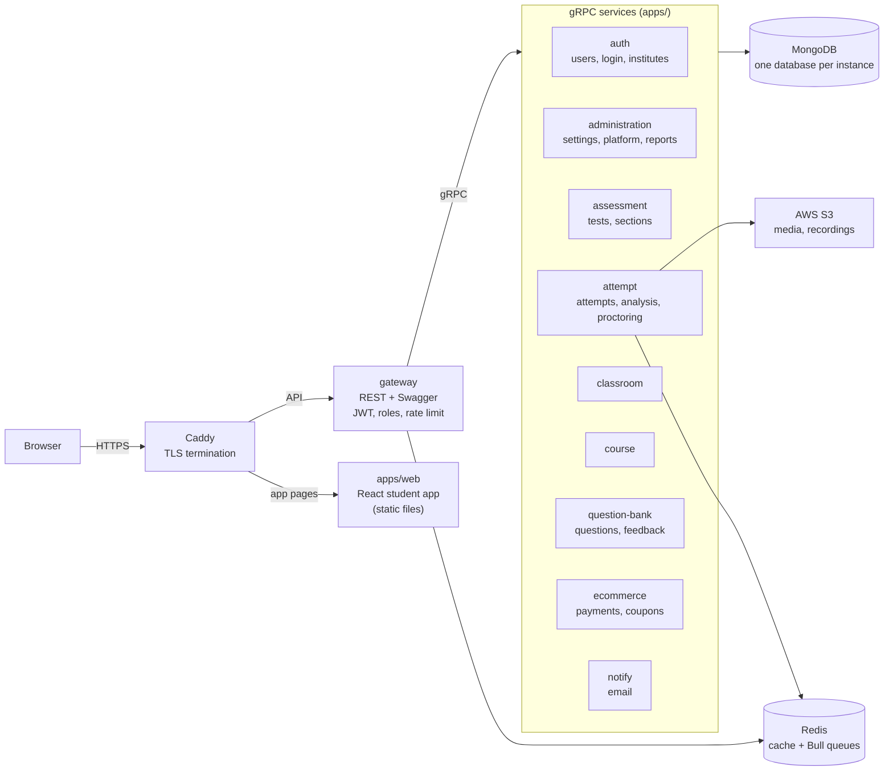
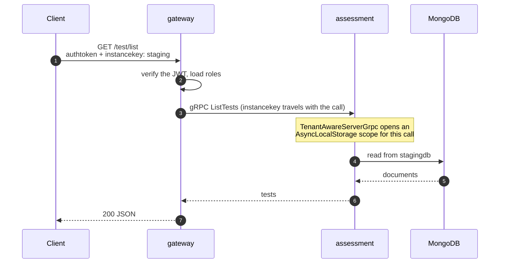

# NestJS Assessment Platform

[](https://github.com/ashfaque-work/nestjs-assessment-platform/actions/workflows/ci.yml)

An online assessment and learning platform (tests, question bank, classrooms, courses, proctoring, e-commerce): a **NestJS microservices** backend and a **React** student app, in one monorepo.

## Live demo

- **[assess.ashfaqueahmad.com](https://assess.ashfaqueahmad.com)**: the web app. The sign-in page fills in either demo
  account: as the **student**, take a timed test and review every answer; as the **teacher**, write and publish a
  test and see a sample class's results.
- **[assess.ashfaqueahmad.com/api](https://assess.ashfaqueahmad.com/api)**: Swagger UI for the API.

All 10 services, MongoDB, Redis and the web app run in Docker on a single 2-core ARM VM.

To call a protected endpoint from Swagger or curl:

1. `POST /auth/login` with the header `instancekey: staging` and body
   `{ "userId": "demo-student@example.com", "password": "DmnTAiBaXDSPM4#7a" }`
2. Send the returned token as the `authtoken` header, together with `instancekey: staging`.

The demo holds sample data only. Everyone shares the demo accounts, so the data is put back to its starting state every night (21:30 UTC).

## Architecture

One public HTTP service in front of nine gRPC services. Only the gateway is reachable from
the internet; the services talk to each other over gRPC on a private Docker network.



Every RPC carries the caller's `instancekey`, which decides the database the repositories read:



A second concurrent request for another instance runs in its own scope, so the two never
share the key.

| Path | What it is |
|---|---|
| `apps/web` | Web app for students and teachers: React, TypeScript, Vite, TanStack Query, Tailwind |
| `apps/gateway` | Public HTTP API. Validates the JWT, checks roles, forwards calls to services over gRPC |
| `apps/<service>` | gRPC microservices, one per domain |
| `apps/video-streaming` | Experimental mediasoup WebRTC server |
| `libs/common` | Shared code: Mongoose schemas and repositories, DTOs, gRPC clients, auth guards, config |
| `proto/` | gRPC contracts (about 950 RPCs) |

### Multi-instance (multi-tenant) databases
Every request carries an `instancekey` header that selects the MongoDB database for that instance (see `libs/common/src/config`).
Repositories read the key from a per-request `AsyncLocalStorage` context (`libs/common/src/database/tenant-context.ts`), so concurrent requests for different instances stay isolated.

## Requirements
- Node.js 22+
- MongoDB 6+
- Redis 6+

## Setup

```bash
npm install
cp .env.example .env   # then edit values
```

All configuration (database URIs, Redis, JWT secret, AWS, email) comes from environment variables. No credentials are stored in the repository.
Set `APP_ENV=dev` for development.

## Running

Each service is started separately (one terminal per service), for example:

```bash
npx nest start auth --watch
npx nest start gateway --watch
```

Start `auth` plus the services you need, then `gateway`. Swagger UI is available at `http://localhost:8000/api`.

Production build of one service:

```bash
npx nest build gateway
node dist/apps/gateway/main.js
```

## Docker

Every service has a multi-stage `Dockerfile` in `apps/<service>/`. To run the whole stack (all services, Redis and MongoDB):

```bash
cp .env.example .env
docker compose -f docker-compose.local.yml up --build
```

Configuration is passed as environment variables; no `.env` file is copied into the images.

The live demo's server setup (Caddy, the compose overrides, build, backup, health-check and nightly reset scripts) is in [`deploy/`](deploy/README.md).

## Authentication
- `POST /auth/login` returns a JWT. Send it as the `authtoken` header together with `instancekey`.
- `AuthenticationGuard` verifies the token and loads the user; `RolesGuard` checks the user's roles from the database.
- `GET /auth/refreshToken` issues a new token only for a validly signed token that belongs to an existing session,
  within 7 days of its expiry, and never for a deactivated account.
- A deactivated account cannot sign in, and its existing tokens stop working at once.
- Signing up (`POST /auth/users`) gives the student or teacher role only; staff roles are given by staff.
- `PROTECTED_ACCOUNTS` (emails, comma separated) lists accounts nobody may change: roles, status, details or
  password. Use it for shared demo accounts.
- `SIGNUP_INSTITUTE_ID` (a location id) is the institute people who sign up themselves join, taking its subjects,
  so a new student sees that institute's tests at once.
- A forgotten password is reset by email: `POST /auth/recoverPassword` answers the same whether or not the account
  exists and emails a link to `/set-password?token=...` (settings `baseUrl`). The token is random, works for an hour,
  once, and is dropped after 5 wrong tries.
- Staff changes to people (added, edited, roles, deactivated or reactivated) and to settings are kept in an audit
  log, read by admins and directors at `GET /auth/audit` and on the web at `/admin/audit`.

## Web app

`apps/web` has its own `package.json`.

- **Everyone** can ask for a link to set a new password from the sign-in page.
- **Students** sign up, see open tests and past results, take a timed test (answer sheet navigator, mark for review,
  keyboard shortcuts, answers kept if the page reloads; the clock runs from the server's start time), then review the
  marked answer sheet with explanations and a breakdown by topic. The profile page changes their name and password.
- **Teachers** write tests (single- and multiple-answer questions with an answer key and explanations, time, marking,
  attempts per student, an opening and a closing date, every student or only invited emails), preview a test as a
  student sees it, reorder questions, publish, duplicate, withdraw or delete drafts, and read
  the class answer sheet: every student's answers to every question, the share of the class that got each one right,
  the hardest question, late hand-ins, each student's own answer sheet, and a CSV download.
- **Admins** manage people (search and pages on the server; add, edit name, subjects, teacher verification and
  password, roles, deactivate and reactivate), the platform settings, and read the audit log.

```bash
cd apps/web
npm install
npm run dev     # http://localhost:5173, API calls proxied to the live gateway
API_TARGET=http://localhost:8000 npm run dev   # or to a local gateway
npm test
npm run build   # static files in apps/web/dist
```

In production the built files are served by the same Caddy that fronts the gateway: `/`, `/login`, `/signup`,
`/profile`, `/forgot-password`, `/set-password`, `/tests/*`, `/results/*`, `/teach/*`, `/admin`, `/admin/users`,
`/admin/settings`, `/admin/audit` and `/assets/*` are the
app, everything else goes to the API, so the app needs no CORS setup.

## Tests

```bash
npm test                    # backend (Jest)
npm --prefix apps/web test  # web app (Vitest)
npm run test:api            # API suites against a running stack (below)
```

### API tests

`test/api` checks the running services end to end over HTTP: who may do what, grading, schedules and attempt
limits, invitations, settings, the audit log and password reset. Each suite first **drops and refills** its
database with fixed test data, so point it at a database you can throw away, never a real one.

Start the stack against that database, with the gateway's login limit raised and the test accounts set up:

```bash
# .env: MONGO_URI_* pointing at the throwaway database
export REDIS_ISMOCK=true LOGIN_THROTTLE_LIMIT=100000   PROTECTED_ACCOUNTS=admin@example.com SIGNUP_INSTITUTE_ID=000000000000000000000010
npm run build && node dist/apps/<each service>/main.js   # gateway, auth, administration, assessment, attempt, question-bank

API_TEST_MONGO=mongodb://127.0.0.1:27017 API_TEST_DB=stagingdb npm run test:api
node test/api/run.mjs attempts    # one suite: accounts, attempts, platform or teaching
```

`API_BASE` (default `http://localhost:8000`) and `API_TEST_INSTANCE` (the `instancekey`) are the other settings.
